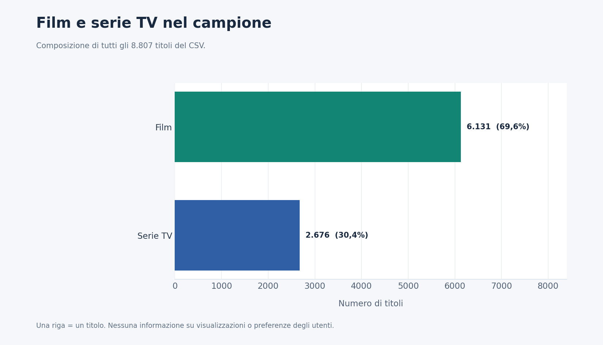
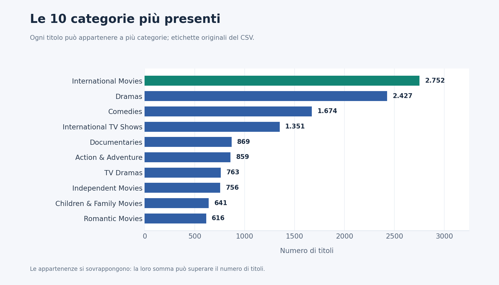
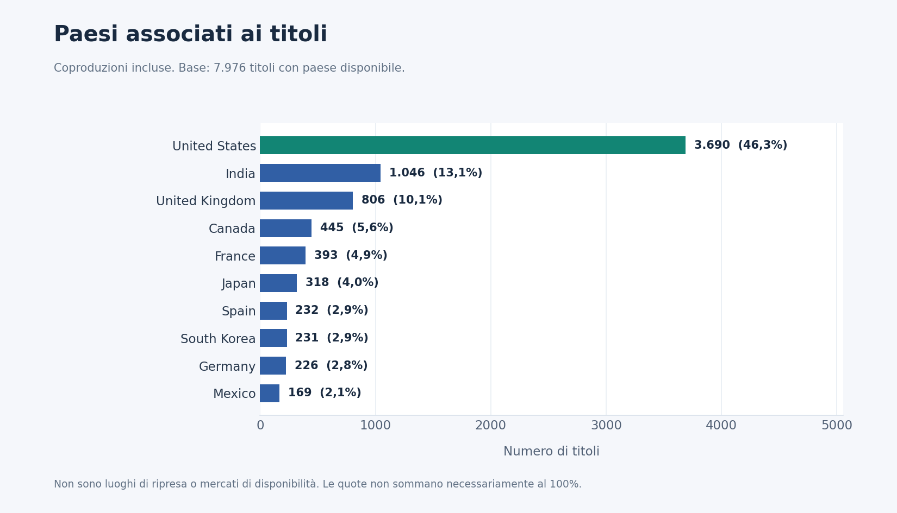
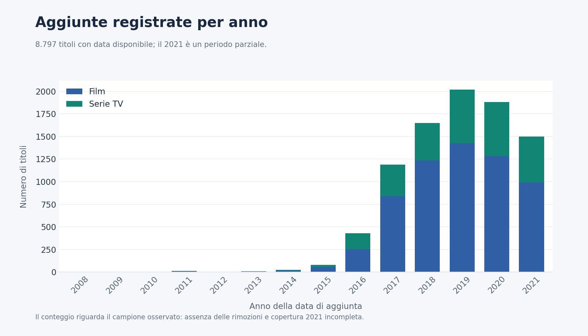
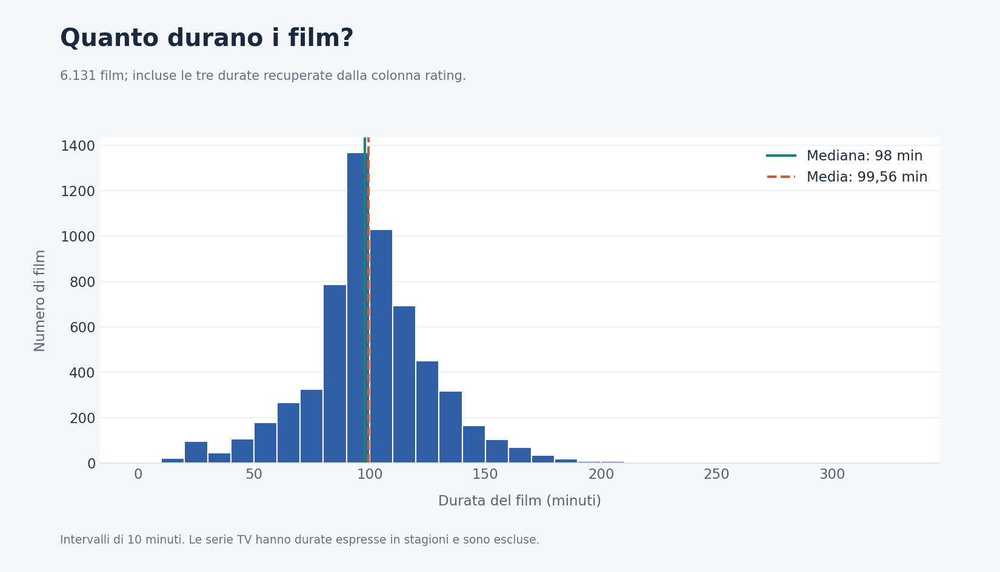
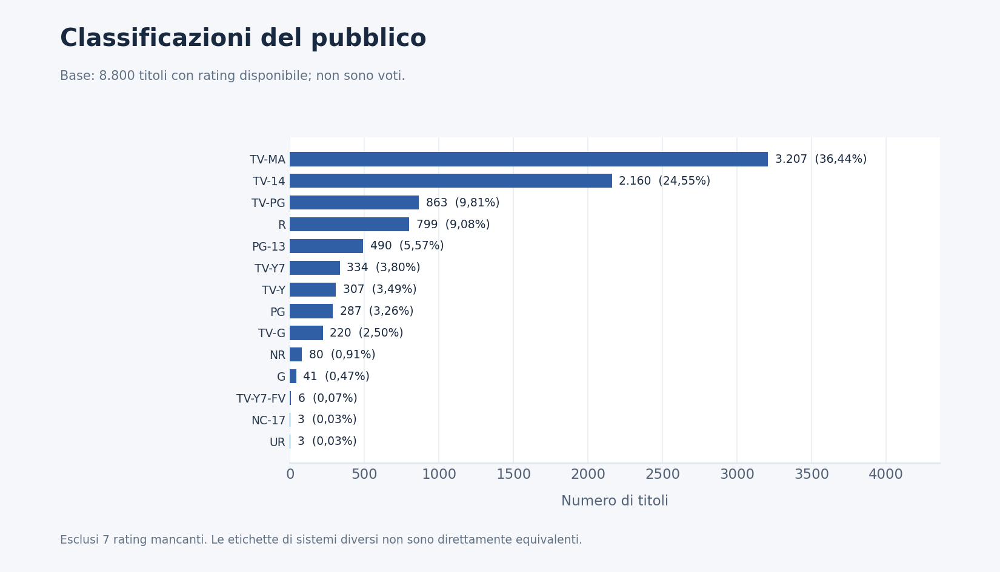
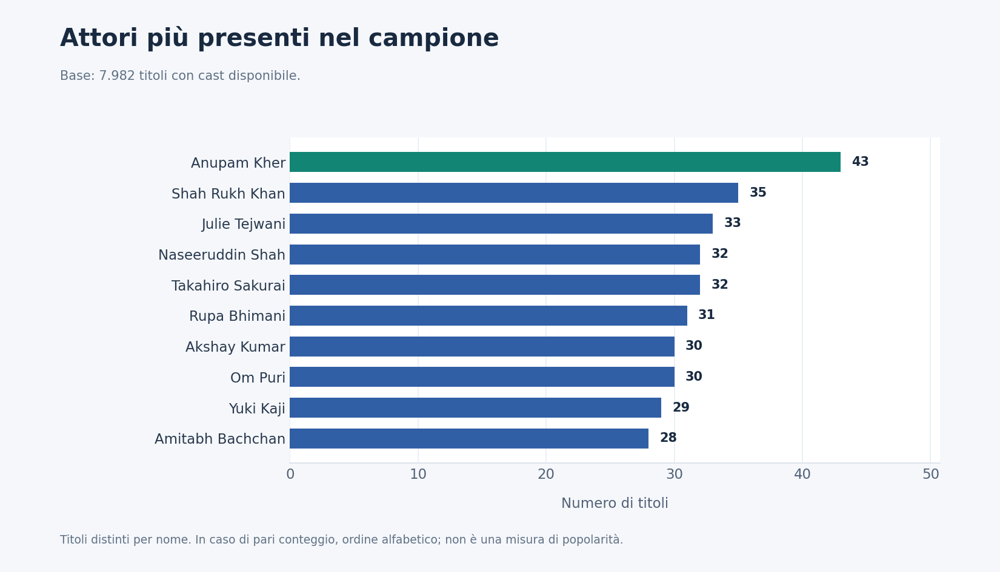
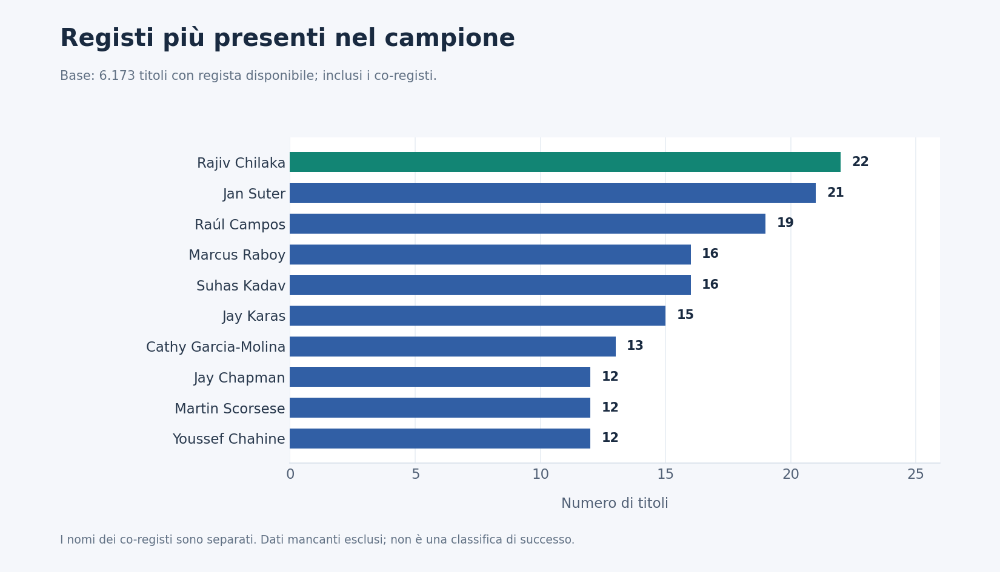

# Netflix Data Analysis

Analisi esplorativa di un dataset storico di **8.807 titoli Netflix**, con Python, pandas, NumPy e Matplotlib.

## Obiettivo e metodo

Analizzare la composizione dei contenuti, i paesi associati, le categorie, le aggiunte nel tempo e la durata dei film.

Sono stati controllati i dati mancanti, recuperate tre durate inserite nella colonna errata e separati i campi contenenti più paesi, attori e registi. Ogni analisi utilizza i titoli con le informazioni necessarie, senza eliminare globalmente le righe incomplete.

## Film e serie TV

I film rappresentano il **69,6%** dei titoli del campione. Questa percentuale descrive la composizione del dataset, non le preferenze degli utenti.

## Categorie più presenti

Un titolo può appartenere a più categorie: i conteggi si sovrappongono e non devono sommare al totale dei titoli.

## Paesi associati ai titoli

Le coproduzioni vengono conteggiate per ciascun paese indicato. Il campo non identifica i luoghi delle riprese né i mercati in cui i titoli erano disponibili.

## Aggiunte nel tempo

Il picco delle aggiunte registrate è nel **2019, con 2.016 titoli**. Il 2021 è parziale e il dataset non documenta le rimozioni: questi dati non ricostruiscono la dimensione storica completa del catalogo.

## Durata dei film

La durata mediana è di **98 minuti**, mentre la media è di **99,56 minuti**. L’analisi comprende i 6.131 film; le serie sono escluse perché la loro durata è espressa in stagioni.

## Classificazioni del pubblico

Il rating indica la classificazione del pubblico, non un voto di gradimento. Sono esclusi i sette titoli senza rating disponibile.

## Attori più presenti

Numero di titoli distinti associati a ciascun attore nel cast disponibile. Il conteggio non misura popolarità o visualizzazioni.

## Registi più presenti

I co-registi vengono conteggiati separatamente. Sono esclusi i dati mancanti; a parità di conteggio, l’ordine è alfabetico.

## Competenze applicate

**Python · pandas · NumPy · Matplotlib**

- Controllo della qualità e gestione dei dati mancanti.
- Pulizia, trasformazione e normalizzazione dei dati.
- Analisi esplorativa e statistica descrittiva.
- Analisi temporale e confronto tra categorie.
- Visualizzazione dei dati e interpretazione dei risultati.
- Documentazione del metodo e dei limiti dell’analisi.

## Dataset e limiti

Il CSV contiene metadati storici sui titoli, con date di aggiunta disponibili dal 2008 al settembre 2021. Non contiene visualizzazioni, ricavi o preferenze degli utenti.

Nome e struttura sono compatibili con il dataset [Netflix Movies and TV Shows](https://www.kaggle.com/datasets/shivamb/netflix-shows); la provenienza del singolo download non è verificabile dal file.

Le conclusioni riguardano esclusivamente il campione storico, non il catalogo Netflix attuale. Progetto indipendente, non affiliato a Netflix.

## Consultazione

Questa pagina pubblica presenta metodo, grafici e risultati. Codice, notebook e dataset sono conservati in un repository privato.

[Torna al profilo](https://github.com/AntonioDiRauso27)
