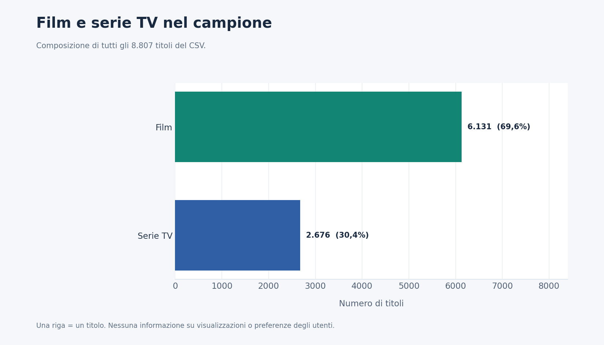
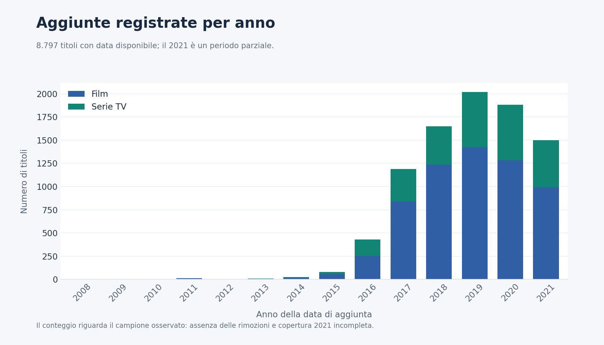
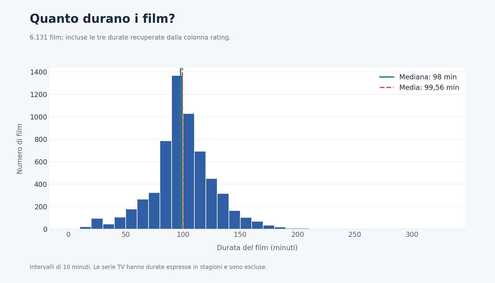
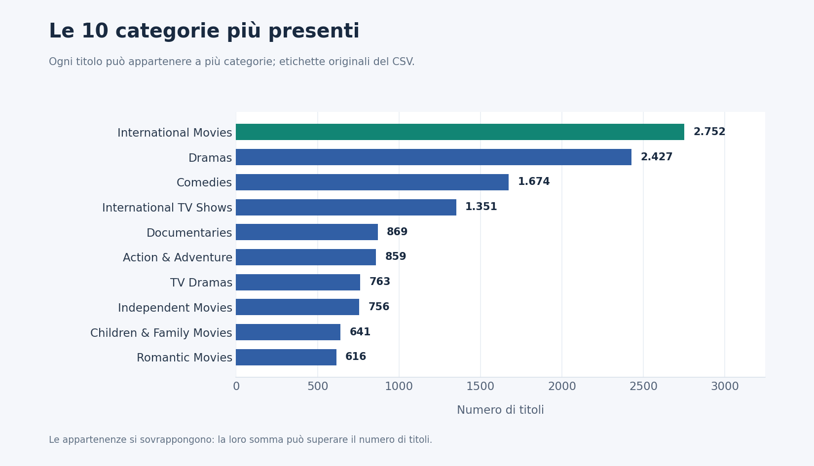
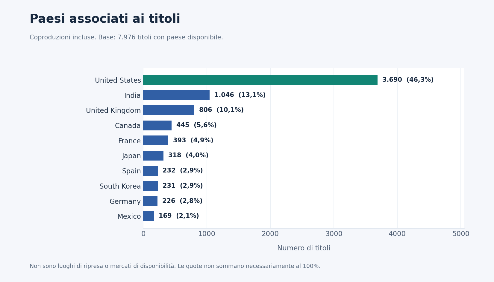
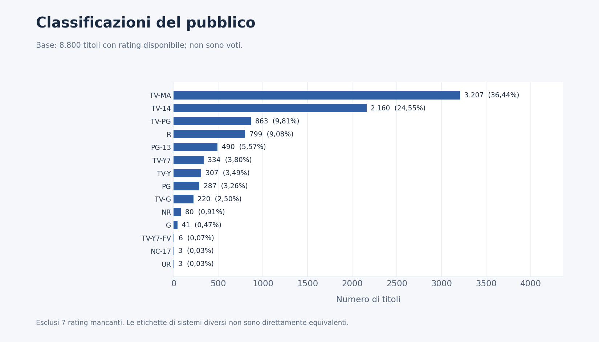
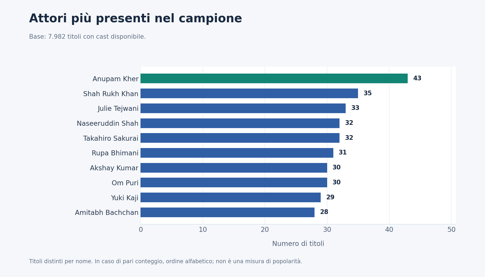
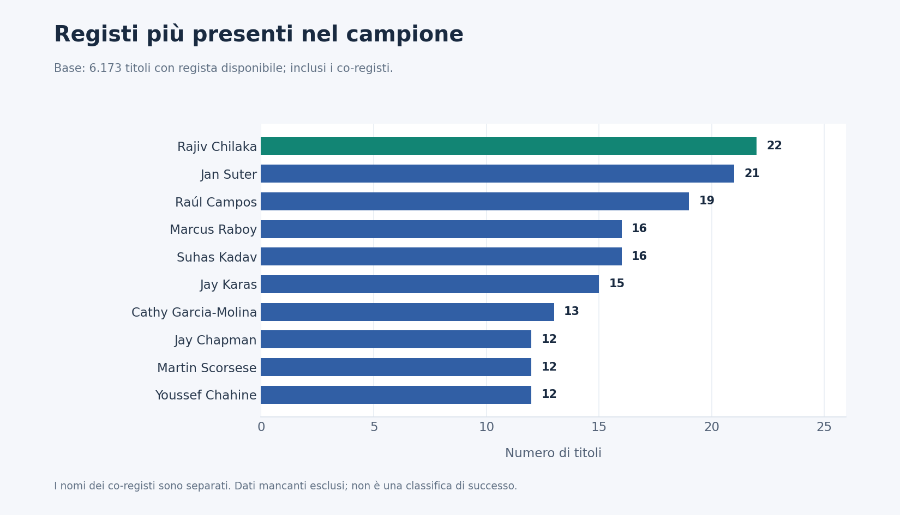

# Antonio Di Rauso

### Data Analyst | AI Automation Specialist | Software Development

Analisi dati, reportistica e automazione dei processi. Sviluppo applicazioni e dashboard interattive per rendere le informazioni più accessibili, supportare le decisioni e semplificare le attività operative.

## StudioHub — Demo video

Piattaforma Python per studi professionali: organizza i PDF e assegna le fatture XML alle rispettive aziende, riconoscendo i duplicati e segnalando i casi da verificare. Include controlli paghe, report grafici, verifica degli incassi e salvataggio automatico delle lavorazioni.

🎬 [Guarda la demo con sottotitoli — 70 secondi](https://github.com/AntonioDiRauso27/AntonioDiRauso27/raw/refs/heads/main/StudioHub_Demo_Sottotitoli.mp4)

Demo con dati fittizi. Codice e applicazioni restano privati.

## Netflix Data Analysis

Analisi esplorativa di un dataset storico di 8.807 titoli Netflix, con Python, pandas, NumPy e Matplotlib.

Il progetto approfondisce qualità dei dati, composizione tra film e serie TV, categorie, paesi associati, aggiunte nel tempo e durata dei film.

Sono stati gestiti dati mancanti, recuperate durate inserite nella colonna errata e separati i campi contenenti più paesi, attori e registi.

### Film e serie TV

I film rappresentano il 69,6% dei titoli del campione. Questa percentuale descrive la composizione del dataset, non le preferenze degli utenti.

### Aggiunte nel tempo

Il picco delle aggiunte registrate è nel 2019, con 2.016 titoli. Il 2021 è parziale e il dataset non documenta le rimozioni dal catalogo.

### Durata dei film

La durata mediana è di 98 minuti, mentre la media è di 99,56 minuti.

### Categorie più presenti

Un titolo può appartenere a più categorie: i conteggi non rappresentano gruppi separati e non devono sommare al totale dei titoli.

### Paesi associati ai titoli

Le coproduzioni vengono conteggiate per ciascun paese indicato. Il campo non identifica i luoghi delle riprese né i mercati in cui i titoli erano disponibili.

### Classificazioni del pubblico

Il rating indica la classificazione del pubblico, non un voto di gradimento. Sono esclusi i sette titoli senza classificazione disponibile.

### Attori più presenti

Numero di titoli distinti associati a ciascun attore nel cast disponibile. Il conteggio non misura popolarità o visualizzazioni.

### Registi più presenti

I co-registi vengono conteggiati separatamente. Sono esclusi i dati mancanti; a parità di conteggio, l’ordine è alfabetico.

Codice, notebook e dataset sono conservati in un repository privato. Le analisi riguardano il campione storico e non il catalogo Netflix attuale.

## Progetti

| Progetto | Cosa fa |
| --- | --- |
| [StudioHub — Demo video](https://github.com/AntonioDiRauso27/AntonioDiRauso27/raw/refs/heads/main/StudioHub_Demo_Sottotitoli.mp4) | Riunisce documenti, verifiche paghe, report e incassi, con autosalvataggio e ripresa delle lavorazioni. |
| [ReportFlow](https://github.com/AntonioDiRauso27/ReportFlow) | Trasforma export CSV in dashboard e report trimestrali per più aziende. |
| [Payroll Control](https://github.com/AntonioDiRauso27/Payroll-Control) | Individua casi da approfondire nei dati paghe e permette di documentare le verifiche. |
| [Riconcilia](https://github.com/AntonioDiRauso27/Riconcilia) | Propone abbinamenti tra incassi e fatture, con gestione di pagamenti parziali e casi ambigui. |
| [DocFlow](https://github.com/AntonioDiRauso27/DocFlow) | Propone la classificazione e l'organizzazione di documenti PDF, con revisione dell'operatore. |
| [Titanic Analytics](https://github.com/AntonioDiRauso27/Titanic-Data-Analysis) | Esercitazione di analisi esplorativa con Python, pandas e dashboard interattiva. |
| [Netflix Data Analysis](#netflix-data-analysis) | Analisi esplorativa con Python: qualità dei dati, composizione dei contenuti, analisi temporale e visualizzazione dei risultati. |

## Tecnologie utilizzate nei progetti

- **Analisi dati:** Python · pandas · NumPy · Matplotlib · Seaborn
- **Applicazioni e dashboard:** HTML · CSS · JavaScript · FastAPI · Uvicorn · Jinja2
- **Dati e documenti:** SQLite · pypdf
- **Sviluppo desktop:** Swift · WebKit
- **Compilazione e test JavaScript:** Node.js
- **Test e distribuzione:** GitHub Actions · Playwright · unittest · PyInstaller
- **Formati elaborati:** CSV · JSON · XML · PDF · ZIP
