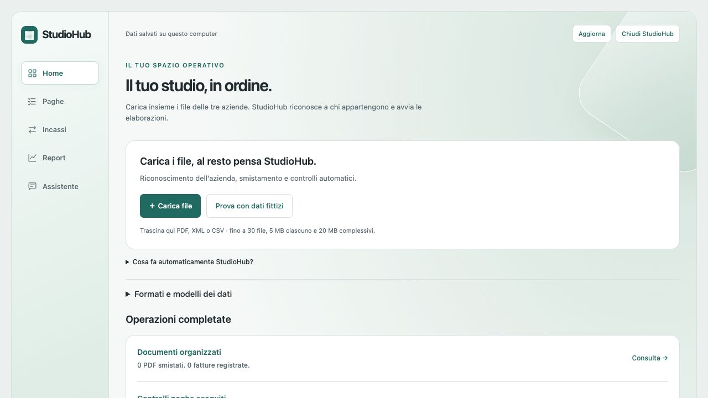
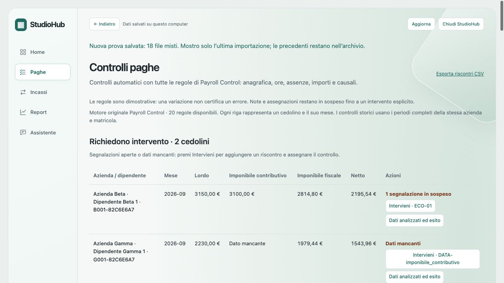
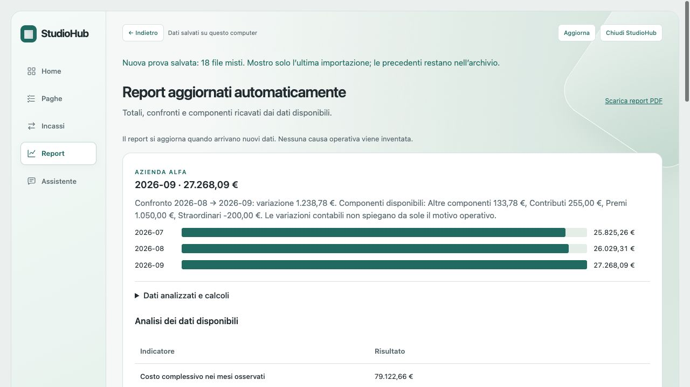

# StudioHub

### Automazione documentale, controlli paghe e analisi dei costi per lo studio professionale

StudioHub è un’applicazione Python che riunisce organizzazione dei documenti, verifica dei dati paghe, riconciliazione degli incassi e reportistica. Il progetto nasce per ridurre i passaggi manuali tra caricamento dei file, controllo dei risultati e documentazione dei riscontri.

**Un unico caricamento avvia più elaborazioni:** il sistema riconosce i dati disponibili, li associa all’azienda di riferimento e aggiorna le sezioni collegate. L’operatore consulta gli esiti e interviene sulle informazioni mancanti o sulle segnalazioni.

🎬 **[Guarda la demo con sottotitoli — 95 secondi](StudioHub_Demo_Sottotitoli.mp4)**

La dimostrazione utilizza Azienda Alfa, Azienda Beta e Azienda Gamma e dati interamente fittizi. Schermate reali dell’applicazione; presentazione guidata, senza audio.

## Dal file all’elaborazione

**Caricamento misto → riconoscimento → assegnazione all’azienda → controlli e confronti → gestione delle eccezioni → esportazione e ripresa del lavoro.**

PDF, fatture elettroniche XML e CSV delle tre aziende possono essere caricati insieme dalla Home. Il contenuto e la struttura del file determinano il flusso di elaborazione. L’ultima importazione è distinta dall’archivio completo, così risultati nuovi e storico restano leggibili.

## Organizzazione documentale automatica

I PDF con destinatario identificabile vengono assegnati all’azienda corretta. Quando mittente e destinatario sono diversi, il riconoscimento considera il destinatario esplicito.

L’originale rimane consultabile. I documenti non identificabili vengono mantenuti come casi da integrare, senza assegnazioni arbitrarie. Le copie organizzate possono essere esportate in ZIP con un registro delle fonti e delle impronte SHA256.

## Fatture XML: lettura e smistamento

Il sistema legge i dati delle fatture XML supportate, riconosce l’azienda dalla partita IVA dell’emittente e acquisisce numero, data, cliente e importo. Il caricamento può contenere fatture appartenenti ad aziende diverse: è StudioHub a smistarle nelle rispettive sezioni.

Il controllo dei duplicati evita il reinserimento delle fatture già riconosciute. Contenuti discordanti riferiti alla stessa fattura vengono segnalati. Le tabelle per azienda espongono importo e residuo degli abbinamenti registrati.

## Paghe: 20 regole e risultati spiegabili

La sezione usa l’intero motore di **Payroll Control**, con controlli su duplicazioni mensili, anagrafica, part-time, ore, assenze, causali, retribuzioni, imponibili e voci variabili. I confronti storici sono separati per azienda e matricola.

Lordo, imponibile contributivo, imponibile fiscale e netto sono distinti. **Richiedono intervento** e **Senza anomalie rilevate** sono liste separate; i casi chiariti restano nello storico dei riscontri.

Il dettaglio **Dati analizzati ed esito** mostra campi del file, controlli disponibili, valori di confronto, scostamenti e riga sorgente. **Intervieni** consente di aggiungere una nota, assegnare il controllo e registrare il chiarimento. Le note non chiudono automaticamente il caso e non modificano il cedolino originale.

## Incassi: abbinamenti e residui aggiornati

StudioHub confronta movimenti bancari CSV e fatture XML/CSV. Quando riferimenti, azienda, cliente, date e importi sono coerenti, registra l’abbinamento e aggiorna il residuo.

Sono gestiti saldi, acconti e più fatture con riferimenti espliciti e somma coincidente. Un nome simile o un importo uguale, da soli, non bastano per confermare un pagamento. I casi ambigui restano separati e possono essere completati integrando il riferimento dalla fonte. Gli abbinamenti sono esportabili in CSV.

## Reportistica e analisi del costo del personale

Con l’importazione dei dati si aggiornano grafici e confronti mensili. L’analisi comprende:

- costo dei mesi osservati, media mensile, massimo e minimo;
- variazioni in euro e percentuale, con evidenza dei mesi non consecutivi;
- composizione del costo e peso delle componenti disponibili;
- copertura temporale e periodi mancanti;
- matricole presenti nei file e costo medio per matricola, se esiste il dettaglio individuale;
- confronto tra le stesse matricole e maggiori variazioni di costo.

Gli approfondimenti sono apribili a richiesta e inclusi nel **report PDF**. I risultati dipendono dai campi effettivamente disponibili: l’applicazione non inventa organici, FTE o motivazioni operative. Una variazione delle componenti spiega il confronto contabile; per ricostruirne il motivo aziendale servono contesto e documenti.

## Consultazione dei dati e continuità del lavoro

L’assistente locale permette di interrogare le aziende e i dati salvati con domande su controlli paghe, fatture, incassi e costi. Le risposte riportano fonti e collegamenti ai casi. È un assistente **a regole, gratuito e senza API**, non un modello generativo.

Le importazioni e gli interventi confermati vengono conservati in SQLite; note e assegnazioni hanno autosalvataggio. Lo storico consente di riprendere il lavoro, distinguere i casi aperti da quelli chiariti e consultare gli originali. La chiusura dell’app attende i salvataggi e arresta il servizio locale.

## Competenze dimostrate dal progetto

- **Automazione dei processi:** riconoscimento dei file, smistamento, controlli e aggiornamento dei risultati.
- **Analisi dati:** aggregazioni, confronti temporali, copertura dei dati e risultati verificabili.
- **Sviluppo software:** applicazione locale con frontend web, importazione di formati diversi ed esportazioni.
- **Gestione dei dati:** persistenza transazionale, duplicati, fonti e storico degli interventi.
- **Verifica:** test automatici del motore paghe, delle analisi, della persistenza e delle esportazioni; workflow dedicato per Windows.

**Tecnologie:** Python · HTML · CSS · JavaScript · SQLite · pypdf · XML · CSV · GitHub Actions · unittest · Playwright · PyInstaller.

## Ambito della dimostrazione

Prototipo locale, predisposto in pacchetti Mac Apple Silicon e Windows x64. La nuova verifica esecutiva Windows deve completare il relativo workflow. Non sono presenti collegamenti diretti a gestionali, email, banche o SharePoint, né accesso condiviso multiutente. I controlli segnalano eccezioni da approfondire e non certificano la correttezza fiscale o contabile.

Codice sorgente e pacchetti dell’applicazione restano **privati**. Questa pagina pubblica contiene soltanto presentazione, immagini e video.
